# otfx

Odin-native terminal text effects. Pipe text in, choose an effect:

```sh
ls -la | otfx decrypt
cat banner.txt | otfx beams
fortune | otfx --random-effect
git log --oneline -10 | otfx matrix
```

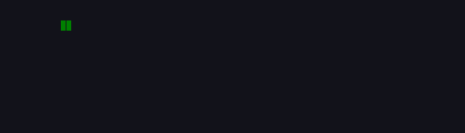

The animation above is generated by `otfx`'s own effect and terminal-cell
renderer, rasterized to GIF by native Odin code with no external image tool. It
animates the FLUXIN banner on an 84×13 canvas at 7×13 pixel cells, using the
upstream `ttfx` gallery's framing.
`otfx` follows the same effect vocabulary and CLI shape as Rust `ttfx`, but it
is a native Odin implementation with a deliberately different renderer and
direct state machines. It does not claim byte-for-byte terminal-stream parity.

## Why otfx

[`ttfx`](https://github.com/omacom-io/ttfx) is a Rust port of
[TerminalTextEffects](https://github.com/ChrisBuilds/terminaltexteffects).
`otfx` is a second, Odin-native implementation aimed at the same practical
job: a small shell-friendly binary that turns piped text into an animation.

The design is data-oriented from the renderer through the effects:

- `#soa[dynamic]Particle` keeps hot particle columns contiguous.
- Effects publish through `set_particle`, `set_appearance`, and field setters.
  The engine handles clipping, cell ownership, and dirty tracking.
- Changed cells are encoded once into fixed slots and emitted as runs that
  start at absolute columns, so unchanged cells and slot padding never reach
  the terminal.
- Effects use flat pools, groups, and direct phase machines. They return whether
  a frame is ready; no parallel render-ID list is required.
- Shared Odin math/linalg and SIMD coordinate rounding serve every effect.

## otfx versus ttfx

| | `otfx` (Odin) | `ttfx` (Rust reference) |
|---|---|---|
| Implementation | SoA engine, direct effect phase machines, shared dirty renderer | fx engine on flat primitives (v0.5.1), original engine as fallback |
| Terminal output | Runs of changed cells from composition dirty bitsets | Differential cell diffing on TTY (v0.5.1); full frame on pipes |
| Supported effects | 37 | 37 |
| CLI for shared effects | Same effect names and option names | Reference contract |
| Deterministic seed | `--seed` resets otfx's engine RNG | `--seed` resets ttfx's RNG |
| Byte-stream parity | Not a goal | Byte-exact against Python TTE (non-TTY) |
| Pre-existing SGR/dynamic color modes | Supported (`ignore`, `dynamic`, `always`, preserving bold/FG/BG) | Supported |
| Terminal resize rebuild | Settled `SIGWINCH` rebuild (and dirty repaint on same-layout resize) | Supported |

All 37 reference command names are exposed by `otfx`, including
**`thunderstorm`**. Every implementation is Odin-native.

This is an important distinction: **effect coverage is not byte-stream
parity.** Given the same seed, the two programs may use different random draws,
frame counts, terminal bytes, and intermediate composition while still
producing the same named effect and honoring its supported option surface.

The original Python TerminalTextEffects implementation is the **accuracy
oracle**; Rust `ttfx` is the **performance oracle**. Visual and behavioral
decisions are checked against Python, while resource comparisons use Rust.
The [37-effect visual review](docs/accuracy-review.md) records sampled behavior,
accepted differences, and remaining coverage limits. Shared ownership and
playback contracts are described in [architecture](docs/architecture.md).

## Performance

The [single-core renderer](docs/architecture.md#frame-emission) emits only the
cells that changed, streaming contiguous single-column runs directly from its
composition dirty bitsets. The [latest release benchmark](docs/release-benchmark.md)
uses **`-o:speed -microarch:native -disable-assert`**, without `-debug`, against
ttfx v0.5.1 (`14ed2742`) run single-threaded, with output to `/dev/null`, a
pipe, and a pseudo-terminal.

Even into `/dev/null`, where writing costs nothing, **OTFX averages 27.53 ms
versus 28.31 ms** (`1.05x` geometric speedup, winning 20/35 effects) while using
**45% less peak RSS** (`12.09 MiB` vs `22.02 MiB`). Once the output goes to a
consumer, OTFX's composition-level dirty emission widens the lead: it writes
**587 MB where ttfx writes 9,602 MB** through pipes (**2.16x faster**), and on a
pseudo-terminal—where ttfx v0.5.1 runs its `DifferentialOutput` cell differ—OTFX
is **2.74x faster** while using **less than one-third the CPU** (`33.31 ms` vs
`107.65 ms`).

| Metric | OTFX | ttfx v0.5.1 |
|---|---:|---:|
| Mean wall per effect, /dev/null | 27.53 ms | 28.31 ms |
| Mean wall per effect, pipe | 29.90 ms | 65.21 ms |
| Mean wall per effect, pty | 41.79 ms | 115.99 ms |
| Bytes written (pipe), 35 effects | 587 MB | 9,602 MB |
| Mean per-effect maximum RSS | 12.09 MiB | 22.02 MiB |
| Startup (slide) | 0.4 ms | 0.7 ms |
| Binary size, as built | 1.27 MiB | 3.02 MiB |
| Binary size, stripped copy | 1.25 MiB | 3.02 MiB |

Measured 2026-11-12. Seed 1, terminal 200×50, dense input/default canvas 190×46,
frame rate 0. Batched samples run at least 0.25 seconds each; whole CLI time and
child CPU/RSS are measured via `wait4`. The reference is ttfx `14ed2742`
(`v0.5.1`) with `TTFX_THREADS=1`.

### By output sink

The benchmark harness writes each child's output to `/dev/null`, a pipe, or a
raw pseudo-terminal (`BENCH_SINK`). With a pipe or pty it drains every byte,
and wall time runs until the last one arrives; a terminal emulator's own
parsing is extra on top.

| Sink | OTFX mean wall | ttfx mean wall | Geometric OTFX speedup | OTFX mean CPU | ttfx mean CPU | OTFX faster |
|---|---:|---:|---:|---:|---:|---:|
| `/dev/null` | 27.53 ms | 28.31 ms | 1.05x | 27.20 ms | 27.97 ms | 20/35 |
| pipe | 29.90 ms | 65.21 ms | 2.16x | 29.13 ms | 53.65 ms | 33/35 |
| pty | 41.79 ms | 115.99 ms | 2.74x | 33.31 ms | 107.65 ms | 34/35 |

### Hardware counters

User-space `perf stat` counters for one complete run of each finite effect into
`/dev/null` on CPU 2, the median of three. L2 misses and fill sources use Zen's
per-core `l2_cache_req_stat` and `ls_any_fills_from_sys` events, so they count
only the measured process. Kernel work and the terminal side are excluded.

| Counter, 35 effects | OTFX | ttfx v0.5.0 |
|---|---:|---:|
| Instructions | 14.05 G | 11.95 G |
| Cycles | 5.10 G | 4.45 G |
| Instructions per cycle | 2.76 | 2.69 |
| Instructions per frame | 146 k | 127 k |
| L1 data loads | 6.91 G | 6.78 G |
| L1 data miss rate | 5.73% | 7.48% |
| L2 misses | 54.1 M | 61.7 M |
| L1 fills served by L3 | 58.8 M | 64.0 M |
| L1 fills served by DRAM | 53 k | 73 k |
| Branch miss rate | 2.46% | 2.31% |
| Data-TLB misses | 410 k | 64 k |

OTFX retires instructions at a similar rate and misses its caches less: its
per-effect L2 misses are a geometric 0.43x of ttfx's. The `/dev/null` gap is
instruction count, about 1.21x per effect, concentrated in Randomsequence, Beams, Highlight, Binarypath and Smoke.
[Per-effect counters](docs/release-fx-counters.tsv).

### Complete finite-effect comparison

Mean wall into `/dev/null`; negative change means OTFX is faster. RSS is the
maximum child RSS across measured samples; bytes are one complete run's output.
Frame counts differ for 21/35 effects, so these are complete-animation costs
rather than equal-frame throughput. Per-effect pipe and pty results are in the
[release report](docs/release-benchmark.md#throughput-by-sink).
[Raw CPU, wall, RSS and frame data](docs/release-fx.tsv).

| Effect | OTFX ms | ttfx ms | OTFX time change | OTFX RSS MiB | ttfx RSS MiB | OTFX MB written | ttfx MB written | Frames OTFX / ttfx |
|---|---:|---:|---:|---:|---:|---:|---:|---:|
| beams | 11.3 | 12.0 | -5.8% | 10.96 | 13.59 | 11.0 | 97.7 | 878 / 732 |
| binarypath | 151.0 | 112.5 | +34.2% | 18.42 | 35.89 | 103.0 | 215.8 | 1909 / 1891 |
| blackhole | 44.6 | 64.6 | -31.0% | 10.21 | 29.35 | 15.6 | 149.0 | 1793 / 1800 |
| bouncyballs | 37.1 | 29.0 | +27.9% | 11.47 | 18.38 | 15.5 | 826.4 | 10364 / 9093 |
| bubbles | 49.3 | 43.5 | +13.3% | 11.49 | 27.02 | 26.5 | 1056.0 | 12184 / 11742 |
| burn | 18.3 | 19.4 | -5.7% | 13.04 | 19.61 | 14.8 | 536.9 | 3218 / 3175 |
| colorshift | 20.3 | 17.7 | +14.7% | 17.01 | 28.25 | 47.3 | 85.3 | 528 / 528 |
| crumble | 37.5 | 48.9 | -23.3% | 12.50 | 33.37 | 19.9 | 94.4 | 2200 / 1835 |
| decrypt | 19.6 | 17.2 | +14.0% | 10.20 | 25.47 | 20.1 | 493.1 | 5442 / 5438 |
| errorcorrect | 11.9 | 19.3 | -38.3% | 9.27 | 18.11 | 8.1 | 862.1 | 5259 / 5237 |
| expand | 16.8 | 19.1 | -12.0% | 9.27 | 15.61 | 3.9 | 32.4 | 302 / 302 |
| fireworks | 46.4 | 59.9 | -22.5% | 10.02 | 23.99 | 10.7 | 136.7 | 1367 / 1553 |
| highlight | 2.5 | 3.5 | -28.6% | 11.11 | 12.23 | 1.3 | 21.5 | 129 / 129 |
| laseretch | 40.6 | 47.0 | -13.6% | 14.00 | 21.35 | 23.0 | 1270.0 | 14307 / 14306 |
| middleout | 7.4 | 9.7 | -23.7% | 11.12 | 18.35 | 1.6 | 9.6 | 235 / 235 |
| orbittingvolley | 19.9 | 17.6 | +13.1% | 10.39 | 13.65 | 10.3 | 109.3 | 1157 / 1156 |
| overflow | 11.3 | 13.0 | -13.1% | 15.43 | 21.09 | 16.2 | 48.4 | 231 / 306 |
| pour | 16.2 | 17.4 | -6.9% | 9.45 | 16.09 | 8.3 | 623.6 | 7160 / 7160 |
| print | 7.2 | 7.1 | +1.4% | 11.16 | 15.68 | 6.4 | 1084.5 | 10057 / 10057 |
| rain | 18.1 | 19.1 | -5.2% | 11.70 | 19.86 | 7.8 | 424.5 | 4760 / 4737 |
| randomsequence | 3.5 | 4.0 | -12.5% | 11.00 | 14.26 | 1.7 | 22.5 | 208 / 208 |
| rings | 77.2 | 97.2 | -20.6% | 12.67 | 36.66 | 28.1 | 94.9 | 1563 / 1566 |
| scattered | 29.4 | 25.9 | +13.5% | 8.70 | 19.09 | 14.9 | 58.4 | 418 / 418 |
| slice | 5.1 | 6.9 | -26.1% | 11.02 | 11.06 | 3.3 | 40.8 | 368 / 368 |
| slide | 16.9 | 12.9 | +31.0% | 11.03 | 15.88 | 12.4 | 33.3 | 375 / 375 |
| smoke | 7.9 | 8.0 | -1.2% | 11.14 | 18.27 | 8.6 | 117.0 | 549 / 565 |
| spotlights | 18.2 | 29.3 | -37.9% | 10.92 | 35.85 | 9.2 | 122.1 | 779 / 800 |
| spray | 26.6 | 27.3 | -2.6% | 12.48 | 20.05 | 13.1 | 76.6 | 1275 / 661 |
| swarm | 98.5 | 96.0 | +2.6% | 20.04 | 55.19 | 28.8 | 461.6 | 4051 / 5041 |
| sweep | 3.8 | 3.8 | +0.0% | 11.64 | 16.02 | 2.5 | 35.6 | 220 / 220 |
| synthgrid | 7.6 | 5.1 | +49.0% | 18.45 | 19.14 | 5.0 | 67.8 | 617 / 619 |
| unstable | 31.1 | 35.2 | -11.6% | 10.95 | 22.40 | 20.3 | 57.4 | 594 / 530 |
| vhstape | 24.7 | 23.4 | +5.6% | 13.39 | 30.17 | 26.2 | 123.0 | 748 / 736 |
| waves | 22.8 | 15.4 | +48.1% | 10.95 | 15.71 | 39.6 | 98.6 | 633 / 633 |
| wipe | 3.0 | 2.9 | +3.4% | 10.71 | 14.02 | 2.4 | 14.8 | 138 / 138 |

Matrix and Thunderstorm run for a configured time and are excluded; see the
[timing-gated diagnostics](docs/release-benchmark.md#timing-gated-comparison).

All **92/92 tests pass** with memory-leak tracking enabled, and `./tools/parity/parity`
completes with 0 failures across all 37 effects; see the
[validation details](docs/release-benchmark.md#validation-and-previews).

### Reproduce

```sh
tools/setup/download_ttfx.sh
third_party/ttfx/bin/build
odin build src -o:speed -microarch:native -disable-assert -out:otfx
odin build bench -o:speed -microarch:native -disable-assert -out:bench/bench
TTFX_THREADS=1 BENCH_MATRIX_RAIN_TIME=1 BENCH_MIN_SECONDS=0.25 ./bench/bench 2
TTFX_THREADS=1 BENCH_MATRIX_RAIN_TIME=1 BENCH_MIN_SECONDS=0.25 BENCH_SINK=pty ./bench/bench 2
```

Use `-define:OTFX_BENCH_BINARY=/path/to/frozen/otfx` to select a frozen candidate.
The report records the ttfx revision, binary hashes, and diagnostic commands.

### Timing-gated effects

Matrix (`--rain-time`) and Thunderstorm (`--storm-time`) run for configured
intervals and are excluded from the throughput aggregate. With pacing disabled,
both can use a full CPU core: a faster update loop does more work within the
same time window. Their elapsed times and frame counts are diagnostics.

At the default 60 fps, sleeping adds wall time but no CPU time. Use `--paced`
to measure CPU per animation, CPU duty (CPU/wall relative to one core), peak RSS,
and actual duration. Thunderstorm has independent choreography, so different
animation durations do not establish a throughput speedup. For deterministic
captures, `--virtual-clock` advances the duration gates by logical frames.

### Documentation previews

The tracked GIF previews are generated by the standalone Odin tool in
[`tools/docs`](tools/docs). It steps the normal effect and renderer pipeline at
fixed input, seed, canvas, and logical frames; rasterizes native Odin image
pixels; and writes GIF directly. It does not parse terminal output, call an
external image tool, or use the ignored Rust checkout.

Glyphs come from a pinned three-font chain vendored into the ignored
`third_party/fonts`: JetBrains Mono for the terminal identity, DejaVu Sans Mono
for the Latin Extended-B tail that `decrypt` scrambles through, and a katakana
subset of Noto Sans Mono CJK for `matrix`. Together they cover every rune the
effects emit, so nothing renders as tofu. Upstream instead renders SVG through
rsvg and inherits whatever fontconfig finds installed, which is why its
`matrix.gif` needs a system CJK font to come out right.

Block elements and box drawing bypass the font entirely and are filled as exact
cell rectangles. A glyph outline scaled to a 7×13 cell does not reach the cell
edge, which puts seams through solid areas of the logo and breaks `synthgrid`'s
rules into dashes.

```sh
tools/setup/vendor_fonts.sh                             # once
odin build tools/docs -out:tools/docs/render_previews
./tools/docs/render_previews                            # all 37
./tools/docs/render_previews decrypt matrix             # or just these
```

The default input is the block-letter FLUXIN banner in [`docs/banner.txt`](docs/banner.txt).
Set `OTFX_DOCS_TEXT_FILE` to use a different text file.

Previews play back in real time: the sampling stride and the GIF frame delay
are derived together from the 60 fps logical clock, so a preview lasts as long
as the effect actually runs.

### Compile time

Single samples measured 2026-10-05 for the current source and ttfx
`921bd551`, on the same loaded host as the benchmark. “Cacheless” means a fresh Rust target directory
or a fresh Odin output path; it does not redownload dependencies. “Repeated”
means the immediate repeat of the same command. Rust reuses compiled artifacts;
Odin's direct build still performs its compilation work. The Rust invalidation
row is one behavior-neutral crate-local constant added after a cached release
build, so it measures a real cached source edit rather than a clean build.

| Build | ttfx Rust debug | ttfx Rust release | otfx Odin debug | otfx Odin release |
|---|---:|---:|---:|---:|
| Cacheless | 5.79 s | 28.24 s | 1.08 s | 10.84 s |
| Repeated | 0.02 s | 0.02 s | 1.01 s | 11.21 s |
| Cached source invalidation | — | 27.50 s | — | — |

Toolchains, CPU parallelism, cache state, and dependency graphs differ, so these
samples do not establish a compiler quality ranking.

## Effects

`otfx` exposes the same 37 effect commands as `ttfx`. Every one is shown
below, animating the FLUXIN banner at seed 3 — all generated by `otfx`
itself, not borrowed from the reference:

### beams

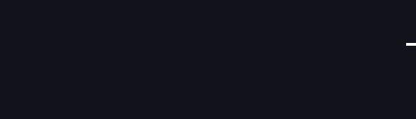

### binarypath

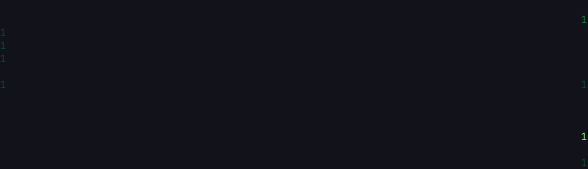

### blackhole

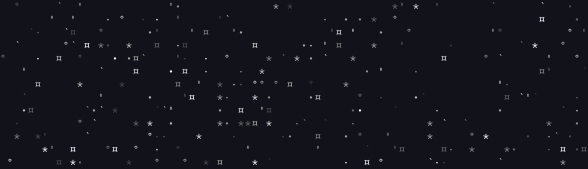

### bouncyballs


### bubbles


### burn

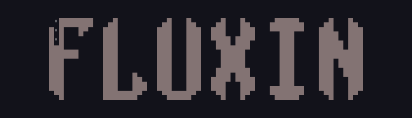

### colorshift

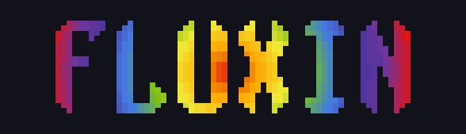

### crumble


### decrypt


### errorcorrect

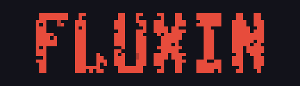

### expand


### fireworks


### highlight


### laseretch

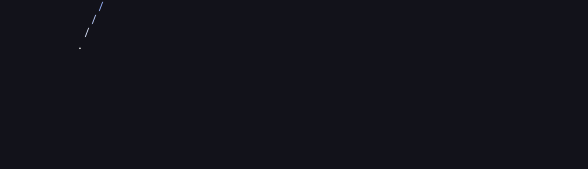

### matrix

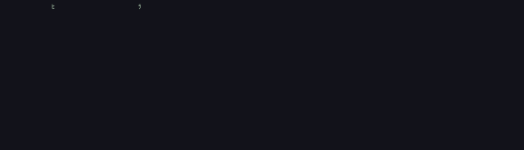

### middleout


### orbittingvolley

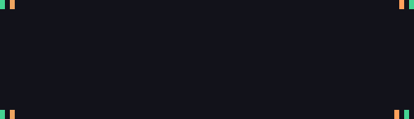

### overflow

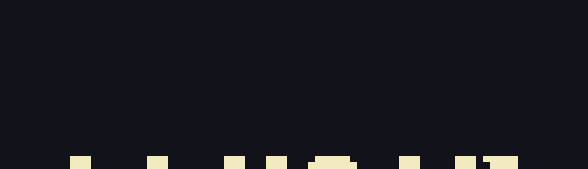

### pour

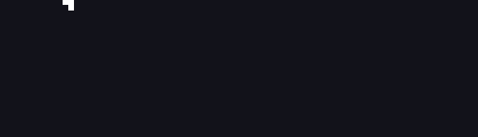

### print

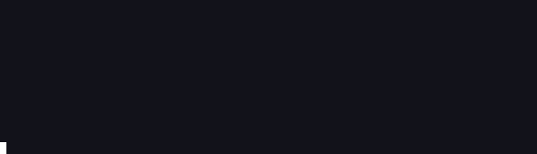

### rain

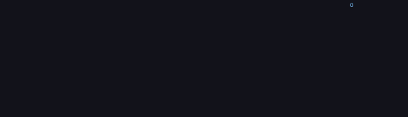

### randomsequence


### rings


### scattered

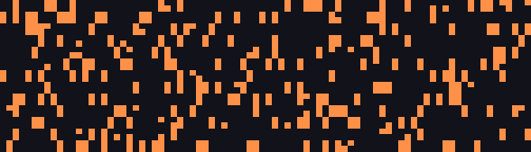

### slice


### slide


### smoke

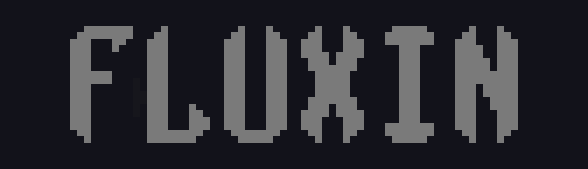

### spotlights

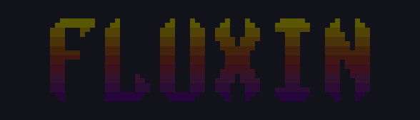

### spray

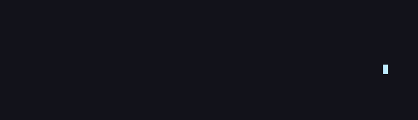

### swarm


### sweep


### synthgrid

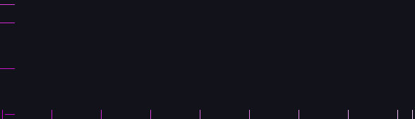

### thunderstorm


Recursive lightning is generated in scalar batches, then flattened for replay.
See the [branch generation and replay contract](docs/architecture.md#thunderstorm).

### unstable

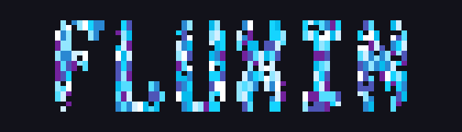

### vhstape

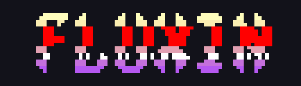

### waves

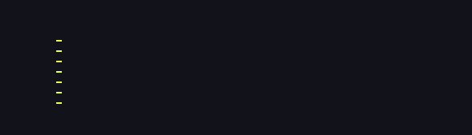

### wipe


Each effect has its own options:

```sh
otfx blackhole --help
otfx matrix --help
otfx bubbles --help
```

## Install

Prebuilt archives are published on [GitHub Releases](https://github.com/fluxin/otfx/releases)
for `linux-x86_64`, `linux-aarch64`, and `macos-aarch64` (Apple Silicon, macOS 11.0+):

```sh
TAG=v0.0.2
curl -fsSL "https://github.com/fluxin/otfx/releases/download/${TAG}/otfx-${TAG}-macos-aarch64.tar.gz" | tar -xz
install -m 755 "otfx-${TAG}-macos-aarch64/otfx" ~/.local/bin/otfx
```

The macOS build is ad-hoc signed and **not notarized**. Installing with `curl`
and `tar` in a terminal works directly. A browser download is quarantined and
macOS blocks the first run; fix it with:

```sh
xattr -d com.apple.quarantine otfx
```

## Usage

```text
<producer> | otfx [terminal options] <effect> [effect options]

otfx --help                 # terminal options and all exposed effects
otfx <effect> --help        # options for one effect
```

Terminal options go before the effect name; effect options go after it.

```sh
# terminal options first
printf 'hello\n' | otfx --seed 42 --frame-rate 0 --canvas-width 80 rain

# effect options after the effect
printf 'hello\n' | otfx --seed 42 bubbles --bubble-delay 1 --rainbow

# restrict random selection to a subset
printf 'hello\n' | otfx --seed 42 -R --include-effects wipe sweep

# advance --storm-time/--rain-time by frames, so an unpaced run is reproducible
printf 'hello\n' | otfx --seed 42 --frame-rate 0 --virtual-clock thunderstorm

# install basic shell completion for the current shell session
source <(otfx --print-completion bash)
```

Supported terminal options include canvas sizing/anchoring, wrapping, color
suppression, terminal background color, input-file selection, reproducible
seeds, random-effect filters, shell-completion generation, and frame pacing.
Run `otfx --help` for the authoritative list.

When stdout is an interactive terminal and canvas geometry follows terminal
dimensions, a settled `SIGWINCH` ends the current run, clears its old canvas
area, and rebuilds the engine and effect against the new layout. Redirected
output and `--ignore-terminal-dimensions` deliberately do not install this
interactive behavior. `--reuse-canvas` is honored for the initial run and is
cleared on a resize because that old DEC cursor anchor has just been erased.

## Building and validation

```sh
tools/setup/download_ttfx.sh
third_party/ttfx/bin/build
odin test tests
odin build src -o:speed -microarch:native -disable-assert -out:otfx
```

`third_party/` is intentionally ignored. The download script pins the Rust
reference revision (`14ed2742`, `v0.5.1`) used for the published comparison
data and never replaces a different local checkout.

The quick supported-effect smoke matrix is:

```sh
for effect in slide beams rings waves matrix decrypt rain wipe scattered expand \
  middleout colorshift highlight sweep randomsequence pour bouncyballs spray \
  slice overflow print errorcorrect unstable smoke burn crumble fireworks \
  spotlights vhstape orbittingvolley synthgrid bubbles binarypath swarm \
  laseretch blackhole thunderstorm
do
  printf 'hello\nworld\n' | COLUMNS=80 LINES=24 \
    ./otfx --seed 42 --frame-rate 0 --max-frames 4 "$effect" >/dev/null
done
```

This validates construction and early-frame execution for every exposed effect.
Regression tests and logical-frame diagnostics are available separately:

```sh
odin test tests
odin build tools/parity -o:speed -out:tools/parity/parity
./tools/parity/parity
```

The diagnostic tool checks Odin completion and final input glyphs and reports
reference frame-count differences without failing on them. Reasonable visual,
RNG, and duration differences are acceptable for meaningful performance gains;
exact reference frames and terminal streams are not acceptance requirements.
[`tools/accuracy`](tools/accuracy) captures paired Python/Odin renderer cells and
contact sheets. The [visual review](docs/accuracy-review.md) records its coverage
and limitations; matching frame counts or final text alone is insufficient.

## Remaining validation work

- Broaden paired Python captures beyond one fixture, seed, and default option set,
  including input SGR, xterm colors, and `always`/`dynamic` behavior.
- Broaden paced CPU measurements independently of unpaced throughput. Matrix and
  Thunderstorm need CPU-duty and duration reporting, not elapsed-time speedups.

## Credit and license

The effect ideas, art direction, and CLI contract originate with
[TerminalTextEffects](https://github.com/ChrisBuilds/terminaltexteffects) by
ChrisBuilds, via the vendored Rust `ttfx` reference. `otfx` retains that
attribution while using an independently structured Odin implementation.

MIT licensed; see [LICENSE](LICENSE) and the
[ttfx reference notices](https://github.com/omacom-io/ttfx).
